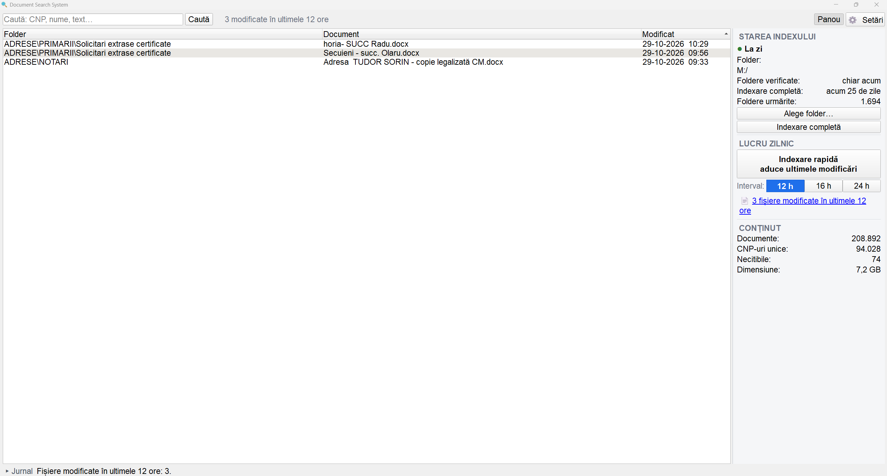

# 🔎 DocSearch

**Instant full-text search across hundreds of thousands of Word documents** (`.doc`, `.docx`, `.txt`) on local or network drives.
Built for real office archives: 180,000+ files on a NAS, searched in milliseconds, kept up to date with incremental re-indexing.

DocSearch 2.0 is a complete rewrite of my earlier single-file tool (`search20.py`) on a clean, layered architecture.



**Tech:** Python · PyQt5 · SQLite FTS5 · olefile · Word COM automation (pywin32) · PyInstaller

---

## ✨ Features

- **Full-text search with SQLite FTS5**: exact-phrase matching with prefix search on the last word, diacritic-insensitive (Romanian `ș ț ă î â` are normalised).
- **Number search**: queries made only of digits search a dedicated index of numeric sequences (5+ digits: ID numbers, file numbers), including partial fragments.
- **Incremental indexing**: one pass over the disk, files with unchanged `mtime` + size are skipped, deleted files are removed from the index. Folders whose date did not change can be skipped entirely.
- **Quick index vs. full index**: the quick index only looks at files changed in the last *N* days (or since the last run); a full index runs on demand.
- **Archive-aware**: year-named folders (`2015`, `2016`, …) older than the last *N* years, and folders you mark as archived, are treated as archive and not rescanned every time.
- **Index health indicator**: a traffic light (green / yellow / red) explains in plain language when the index is out of date and what to do.
- **Database check and remap**: shows where the index points and whether the files still exist on this PC; if the archive moved to another drive letter, a root can be remapped without re-indexing.
- **Network drive friendly**: wakes up mapped drives that Windows leaves "disconnected" after boot, and warns when the database itself sits on a network drive (SQLite WAL is not safe there).
- **Document metadata on hover**: "created by" / "last saved by", read directly from `docProps/core.xml` (`.docx`) or the OLE `SummaryInformation` stream (`.doc`), without opening the document.
- **Responsive UI**: indexing runs in a thread pool, can be **stopped** at any time, and progress updates are throttled to ~5/s so the Qt event loop never chokes.
- **Single instance**: starting the app a second time brings the existing window to the front.

---

## 🛠️ Architecture

```
docsearch/
├── config.py          AppConfig: all settings, debounced atomic save (os.replace)
├── paths.py           where Data/ lives, network-drive detection and wake-up
├── storage/
│   ├── database.py    SQLite + FTS5 behind a SINGLE writer thread
│   └── models.py      DocumentRecord, SearchHit, IndexReport
├── indexing/
│   ├── scanner.py     filesystem walk, age window, excluded / archived folders
│   ├── readers.py     per-extension readers (.docx/.txt from bytes, .doc via Word COM)
│   ├── indexer.py     orchestration: diff, batches, report (no Qt, no SQL)
│   ├── health.py      index health diagnosis (no Qt, directly testable)
│   └── doc_meta.py    author / last-saved-by metadata
├── search/
│   └── normalize.py   diacritics + numeric sequence extraction
└── ui/                PyQt5 windows and QRunnable workers (no SQL, no file reading)
```

### Design decisions

| Problem in the old version | Solution in 2.0 |
|---|---|
| Per-thread connection pool, mixed direct connections, "database is locked" errors, manual WAL file deletion | **One writer thread** fed by a job queue; reads use short-lived connections of their own. WAL works as intended. |
| `LIKE '%…%'` over the full content (no index possible) | **FTS5** full-text index |
| Search cache invalidated on every indexed document | No cache: FTS5 is fast enough |
| `.docx` read from paragraphs only: text in **tables**, **headers** and text boxes was lost | Parsed directly from the XML inside the archive: ~10× faster than python-docx, includes tables, text boxes, headers and footers, skips tracked deletions, constant memory on huge files |
| `.doc` decoded from raw OLE bytes (garbage in the index) | Word COM only, `ReadOnly=True`, one long-lived Word session restarted periodically, guaranteed close |
| A new Word instance per `.doc` file (~0.5 s each) | `WordSession` keeps one instance for the whole run |
| Each `.docx` read twice over the network (hash + text) | Read once as bytes; hash and text come from the same buffer |
| Config saved on every pixel of window resize | Debounced save, at most once per second, atomic |
| Two passes over the disk (count, then index) | Single pass, progress reported on the fly |
| Indexing could not be stopped | **Stop** button, clean cancellation at the next file |

Indexing, health checks and search have no Qt dependency, so the same code runs from the UI, from tests or from the command line.

---

## 🚀 Getting started

Requirements: Python 3.10+ on Windows (Microsoft Word is needed only for legacy `.doc` files; `.docx` and `.txt` work on any OS).

```bash
git clone https://github.com/mmereu97/Search-index-doc-docx.git Project
cd Project
pip install -r requirements.txt
python main.py
```

User data (index database, settings, log) is stored in a `Data/` folder **next to** the project folder (or next to `DocSearch.exe`), never inside the repository:

```
<root>/
├── Project/     this repository
└── Data/        document_index.db, config.json, search_app.log (git-ignored)
```

### Tests

```bash
python test_core.py
```
A self-contained test suite for the core (no UI): 160+ checks covering search semantics, incremental indexing, archive rules, health diagnosis, remapping and document readers. It builds its own `.docx` test files with `python-docx`.

`dev/break_ui_fixture.py` builds a worst-case test archive and opens the real UI against it (empty, one result, 2,000+ results, very long names), with an option to save screenshots, as a visual regression test.

### Building the executable

Double-click `build_exe.bat` (or run `pyinstaller DocSearch.spec`). The output goes to `..\dist\DocSearch\`, outside the repository. Distribute the whole `DocSearch` folder, not just the `.exe`.

---

## 🔒 Security note

The index stores the normalised text of every document, unencrypted. For archives with personal data, keep the `Data/` folder on an encrypted disk (e.g. BitLocker) and restrict folder permissions. Encrypting the database (SQLCipher) is a natural next step.

## 🗺️ Possible next steps

- result snippets using FTS5 `snippet()`
- live folder monitoring (watchdog) instead of periodic re-indexing
- trigram index for substring search on numbers if the volume grows

---

## 👤 Author

Mihai Mereu · [GitHub](https://github.com/mmereu97)
